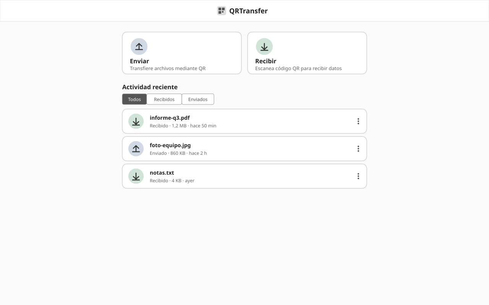
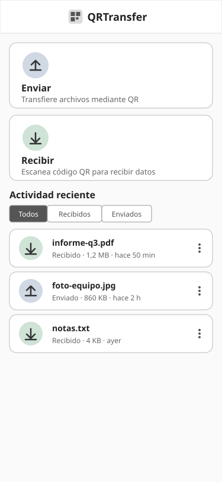

# WF-001: Inicio e historial

<!-- wireframe:review-status=approved -->
**Origen:** [SRS-001: Transferencia de archivos mediante secuencia de QR](../README.md)
**Tipo de solución:** Aplicación web — responsiva
**Estado de revisión:** Aprobado

## Objetivo de la pantalla

Pantalla simple: dos botones con icono (Enviar / Recibir) y, debajo, el historial de transferencias con filtros.

**Requisitos relacionados:** FR-001, FR-007, FR-016, FR-018, FR-019, FR-022, NFR-002, NFR-006

## Estructura

Vista de escritorio (ancho):

Vista móvil (retrato, responsiva):

## Componentes clave

- Botón Enviar (con icono): abre el selector de archivos del dispositivo; al elegir un archivo pasa a WF-002.
- Botón Recibir (con icono): abre WF-004.
- Historial de transferencias con filtro Todos / Recibidos / Enviados.
- Acciones por fila: Exportar y Eliminar.

## Estados de la pantalla

- Historial vacío: Mensaje «Aún no hay transferencias» en lugar de la tabla.

## Historial de revisión

| Fecha | Observación del usuario | Resuelto en |
| ----- | ----------------------- | ----------- |
| 2026-10-08 | Versión inicial generada | — |
| 2026-10-08 | La app debe ser responsiva | Añadida variante móvil `WF-001-inicio-historial-movil.svg`; NFR-006 |
| 2026-10-08 | Interfaz sencilla: 2 botones con icono, historial debajo con filtros; Enviar abre el file picker | SVG de escritorio y móvil rehechos; requisitos relacionados ajustados |
