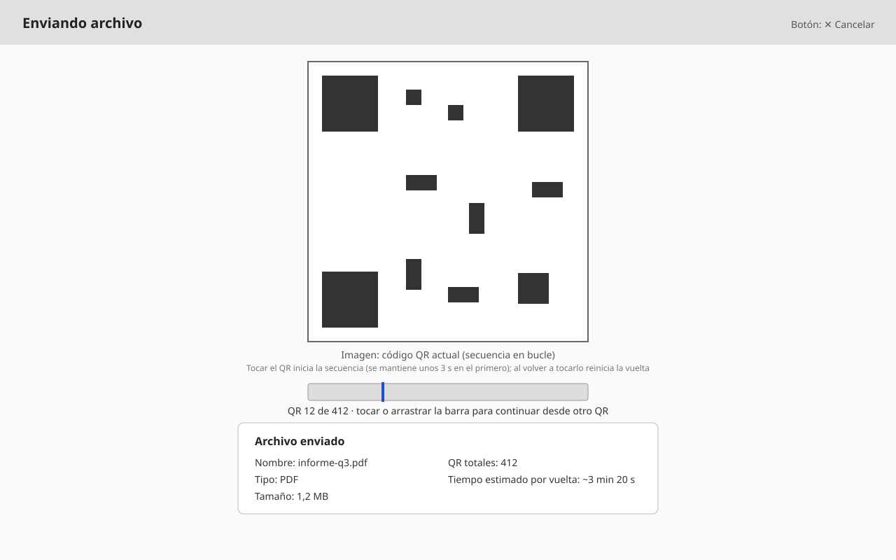
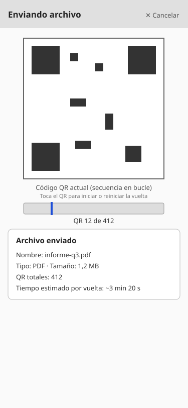

# WF-002: Enviar: QR e información del archivo

<!-- wireframe:review-status=approved -->
**Origen:** [SRS-001: Transferencia de archivos mediante secuencia de QR](../README.md)
**Tipo de solución:** Aplicación web — responsiva
**Estado de revisión:** Aprobado

## Objetivo de la pantalla

Tras elegir el archivo, mostrar únicamente el área con la secuencia de QR en bucle y, debajo, la información del archivo y el tiempo estimado. El emisor no sabe cuánto ha recibido el otro dispositivo (no hay canal de retorno), por lo que no muestra progreso de transmisión.

**Requisitos relacionados:** FR-001, FR-002, FR-003, FR-004, FR-005, FR-006, FR-014, FR-017, FR-018, FR-026, FR-028, FR-031, FR-032, FR-033, FR-035

## Estructura

Vista de escritorio (ancho):

Vista móvil (retrato, responsiva):

## Componentes clave

- Área del QR: muestra el primer QR fijo al elegir el archivo. Es pulsable: el primer toque inicia la secuencia en bucle (velocidad automática) y los siguientes reinician la vuelta; en ambos casos mantiene el primer QR unos 3 s para que el receptor pueda capturarlo (FR-005, FR-026).
- Barra de posición (FR-028): bajo el QR, barra horizontal con una marca vertical que indica qué QR de la vuelta se muestra y, debajo, «QR n de N». Se puede tocar o arrastrar (o usar el teclado) para elegir desde qué QR continúa la secuencia; el QR elegido se retiene unos 3 s.
- Selector «QR a la vez» (FR-035): 1 o 2. Con 2, el área del QR muestra dos QR lado a lado: el primero avanza y el segundo recorre desde el final; la barra de posición lleva una segunda marca (naranja) y el texto indica «QR n y m de N».
- Selector de densidad (FR-032): lista desplegable «Densidad» con 200, 400, 800, 1200 y 1600 B por QR (800 por defecto); cambiarlo reinicia la transferencia y se avisa bajo los selectores.
- Los selectores de densidad y velocidad muestran la última elección del usuario, recordada entre visitas (FR-033).
- Selector de velocidad (FR-031): lista desplegable «Velocidad» con 4, 6, 8, 10 y 12 QR por segundo (8 por defecto), bajo la barra de posición.
- Información del archivo: nombre, tipo, tamaño, QR totales y tiempo estimado por vuelta.
- Botón Cancelar: detiene la transmisión (única forma de terminar la secuencia en el emisor) y libera recursos.

## Historial de revisión

| Fecha | Observación del usuario | Resuelto en |
| ----- | ----------------------- | ----------- |
| 2026-10-08 | Versión inicial generada | — |
| 2026-10-08 | La app debe ser responsiva | Añadida variante móvil `WF-002-enviar-seleccion-movil.svg`; NFR-006 |
| 2026-10-08 | Fusionar selección y transmisión: el QR aparece al elegir el archivo, con la información y el tiempo estimado debajo | SVG de escritorio y móvil rehechos; requisitos relacionados ajustados |
| 2026-10-08 | El emisor no puede saber cuánto se ha transmitido: solo QR e información del archivo | Quitados barra de avance, vuelta actual y texto sobre el receptor; FR-006 ajustado |
| 2026-10-08 | Tocar el QR reinicia la vuelta reteniendo el primero unos 3 s (decisión tras pruebas con dispositivos) | Texto de ayuda añadido bajo el QR en SVG de escritorio y móvil; FR-026 |
| 2026-10-08 | La secuencia no debe iniciar sola: empieza con el primer toque en el QR, con la misma espera | Textos de ayuda actualizados en SVG de escritorio y móvil; FR-005 y FR-026 |
| 2026-10-08 | Barra con marca de posición en el emisor, interactiva, para elegir desde qué QR continuar | Barra añadida en SVG de escritorio y móvil; FR-028 |
| 2026-10-09 | Poder elegir la velocidad de la secuencia | Selector añadido en la descripción; FR-031 |
| 2026-10-09 | Poder elegir el tamaño de fragmento (densidad) | Selector añadido en la descripción; FR-032 |
| 2026-10-09 | Recordar la velocidad y la densidad entre cargas de la página | Texto añadido en la descripción; FR-033 |
| 2026-10-09 | Mostrar dos QR a la vez, uno secuencial y otro desde el final | Descripción actualizada (el wireframe muestra un QR); FR-035 |
