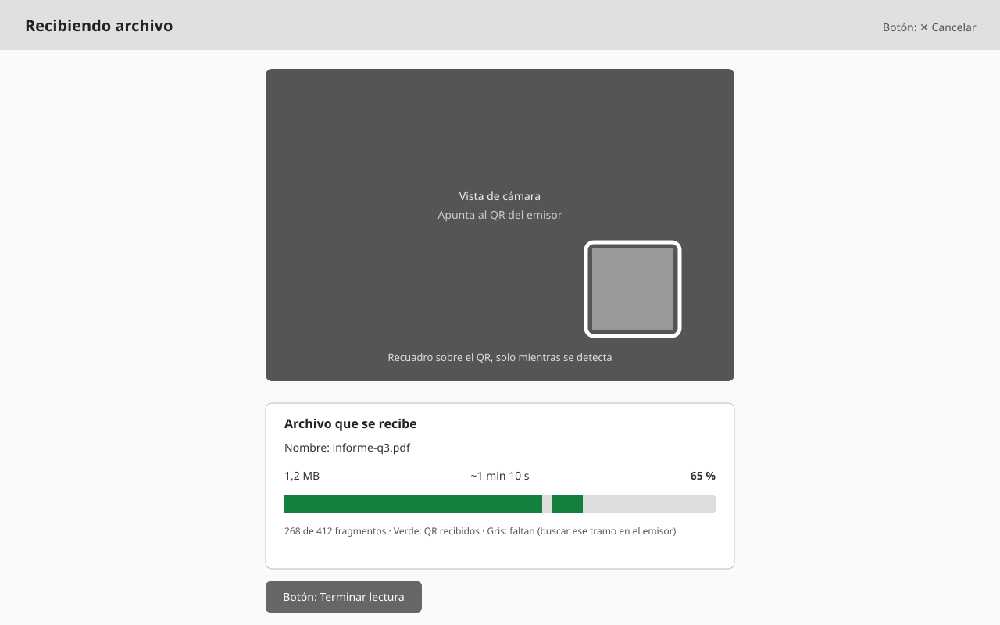
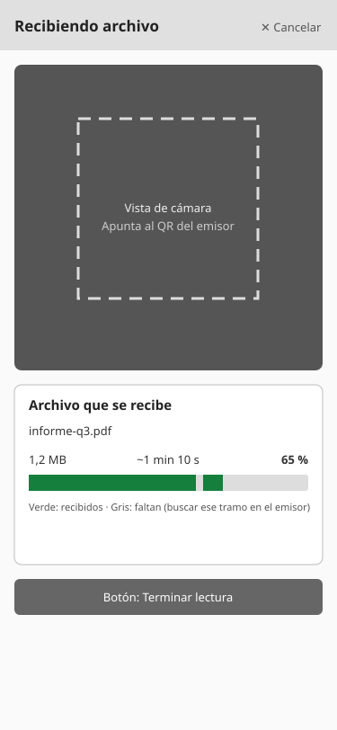

# WF-004: Recibir: escaneo e información

<!-- wireframe:review-status=approved -->
**Origen:** [SRS-001: Transferencia de archivos mediante secuencia de QR](../README.md)
**Tipo de solución:** Aplicación web — responsiva
**Estado de revisión:** Aprobado

## Objetivo de la pantalla

Espacio para escanear los QR con la cámara y, debajo, la información del archivo (tamaño total, tiempo estimado) con una barra de progreso y su porcentaje.

**Requisitos relacionados:** FR-007, FR-008, FR-009, FR-010, FR-008, FR-011, FR-013, FR-014, FR-022

## Estructura

Vista de escritorio (ancho):

Vista móvil (retrato, responsiva):

## Componentes clave

- Vista de cámara con marco de lectura.
- Información: nombre, tamaño total, tiempo estimado restante, fragmentos recibidos de total.
- Barra de progreso con porcentaje transmitido.
- Botón Terminar lectura: el usuario da por terminada la lectura; si faltan fragmentos, el resultado es «incompleta» (WF-005).
- Botón Cancelar: descarta lo recibido y libera la cámara, sin confirmación.

## Estados de la pantalla

- Sin permiso de cámara: Mensaje que pide conceder el permiso y botón para reintentar.
- Esperando primer QR: Información y progreso vacíos hasta leer el primer fragmento.

## Historial de revisión

| Fecha | Observación del usuario | Resuelto en |
| ----- | ----------------------- | ----------- |
| 2026-10-08 | Versión inicial generada | — |
| 2026-10-08 | La app debe ser responsiva | Añadida variante móvil `WF-004-recibir-escaneo-movil.svg`; NFR-006 |
| 2026-10-08 | Pantalla de recibir más simple: cámara arriba; abajo tamaño total, tiempo estimado y barra con porcentaje | SVG de escritorio y móvil rehechos; requisitos relacionados ajustados |
| 2026-10-08 | Definir «incompleta» como decisión del usuario al terminar la lectura | Botón «Terminar lectura» añadido en SVG de escritorio y móvil; FR-013. Aprobado |
