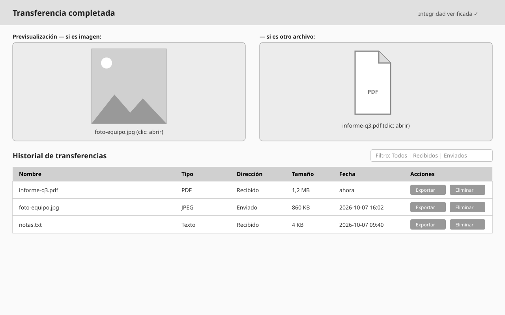
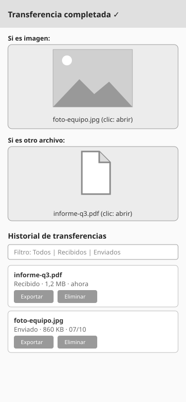

# WF-005: Resultado de la recepción y previsualización

<!-- wireframe:review-status=approved -->
**Origen:** [SRS-001: Transferencia de archivos mediante secuencia de QR](../README.md)
**Tipo de solución:** Aplicación web — responsiva
**Estado de revisión:** Aprobado

## Objetivo de la pantalla

Al recibir todo el archivo, mostrar su previsualización (la imagen, o un icono de archivo con su nombre; al hacer clic se abre el archivo) y, directamente debajo, el historial de transferencias. Si la transferencia no termina bien, informar el resultado.

**Requisitos relacionados:** FR-012, FR-013, FR-014, FR-015, FR-016, FR-020, FR-021, FR-022, NFR-007

## Estructura

Vista de escritorio (ancho):

Vista móvil (retrato, responsiva):

## Componentes clave

- Previsualización: si el archivo es imagen, se muestra la imagen; si es otro tipo, un icono de archivo con su nombre.
- Clic en la previsualización: abre el archivo.
- Historial de transferencias debajo, con filtros y acciones Exportar / Eliminar (como en WF-001).

## Estados de la pantalla

- Error (incompleta, datos inválidos, no reconstruible): tarjeta de resultado con su acción (Seguir escaneando / Reintentar) y el historial debajo; no se guarda ningún archivo — [escritorio](./WF-005-resultado-recepcion-error.svg), [móvil](./WF-005-resultado-recepcion-error-movil.svg).

## Historial de revisión

| Fecha | Observación del usuario | Resuelto en |
| ----- | ----------------------- | ----------- |
| 2026-10-08 | Versión inicial generada | — |
| 2026-10-08 | La app debe ser responsiva | Añadida variante móvil `WF-005-resultado-recepcion-movil.svg`; NFR-006 |
| 2026-10-08 | Al terminar mostrar previsualización (imagen, o icono con nombre; clic abre el archivo) y debajo el historial | SVG rehechos (éxito y error, escritorio y móvil); FR-020 nuevo |
